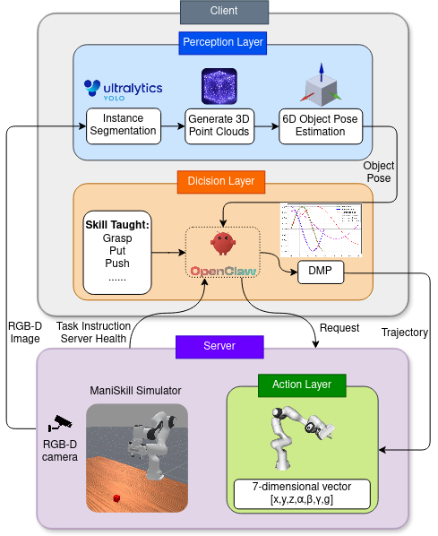
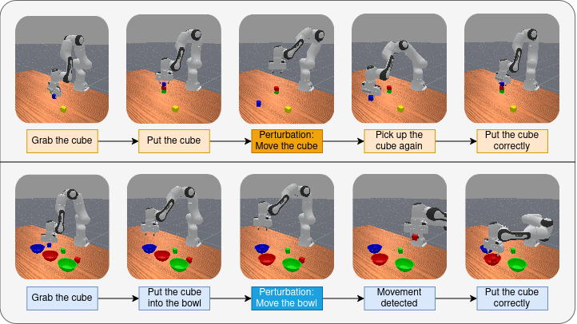

# VigiClaw



​	VigiClaw 是一个基于 OpenClaw 的机械臂仿真与控制项目，使用的仿真环境是ManiSkill。用于把Openclaw接入到ManiSkill仿真环境中，然后用自然语言指令控制机械臂完成任务。VigiClaw名称是Vigilant Openclaw的缩写，代表警觉的Openclaw。这个项目也可以使用其他Agent框架如codex。论文名称：**VigiClaw: Action-Triggered State Verification for Robust Long-Horizon Robotic Manipulation**。

## 环境要求

- Linux 或其他支持 SAPIEN/ManiSkill 的系统
- Python `>=3.10,<3.13`
- 可用的 GPU/图形环境，因为开启仿真。
- ManiSkill `>=3.0.1`

## 安装

### 使用 uv（推荐）

```bash
git clone https://github.com/<your-name>/VigiClaw.git
cd VigiClaw

uv venv
uv sync
source .venv/bin/activate
```

### 使用 pip

```bash
git clone https://github.com/<your-name>/VigiClaw.git
cd VigiClaw

python3 -m venv .venv
source .venv/bin/activate
pip install -e .
```

视觉 Skill 脚本还需要额外依赖，按实际使用的脚本安装：

```bash
pip install requests numpy Pillow opencv-python ultralytics
```

### 安装YOLO 环境

本项目的物体检测和视觉定位 Skill 使用 Ultralytics YOLO，推荐使用名为 `yolo26` 的 Conda 环境：

```bash
conda create -n yolo26 python=3.10 -y
conda activate yolo26
pip install requests numpy Pillow opencv-python ultralytics
```

如果 `yolo26` 环境已经存在，只需要执行：

```bash
conda activate yolo26
pip install requests numpy Pillow opencv-python ultralytics
```

运行视觉脚本前，请确保已经激活该环境：

```bash
conda activate yolo26
cd skill/scripts
conda run -n yolo26 python object_detect.py
```

### 安装OpenClaw

这里默认安装完成OpenClaw。

## OpenClaw 任务列表

项目通过 `openclaw_task` 注册了以下 OpenClaw 任务：

| 任务名称                     | 任务简介                                                     | 是否可用 |
| ---------------------------- | ------------------------------------------------------------ | -------- |
| `OpenclawPickCube`           | 抓取红色方块，并将其提起到指定高度。                         | √        |
| `OpenclawPickCup`            | 从两个颜色不同但形状相同的杯子中，抓取指定目标杯子并提起。   | √        |
| `OpenclawPickBanana`         | 抓取香蕉，并将其提起到指定高度。                             | √        |
| `OpenclawMoveApple`          | 抓取苹果，按照随机指定的方向移动一定距离后放下。             | √        |
| `OpenclawPutBananaOnPlate`   | 抓取香蕉并将其放到盘子上。                                   | √        |
| `OpenclawStackCubes`         | 按顺序将红色方块堆叠到绿色方块上、蓝色方块上，最后将黄色方块堆叠到蓝色方块上。 | √        |
| `OpenclawDailyScene`         | 在包含棒球、香蕉、杯子、苹果和马克笔的日常场景中，根据指令抓取工具（默认指马克笔）。 | √        |
| `OpenclawPutTogether`        | 将红、绿、蓝三个方块分别放入对应颜色的碗中。                 | √        |
| `OpenclawStackCubesDisturb`  | 完成红、绿、蓝方块的堆叠，并将蓝色方块堆叠到红色方块上；任务过程中可能发生方块干扰。 | √        |
| `OpenclawPutTogetherDisturb` | 将方块放入对应颜色的碗中；任务过程中可能出现方块回移或碗移动等干扰。 | √        |
| `OpenclawOpenCabinet`        | 打开柜子，并抓取柜子内部的物体。                             | ×        |
| `OpenclawPushCube`           | 推动目标方块，按照随机指定的方向移动一定距离。               | √        |
| `OpenclawObstacleAvoid`      | 绕过蓝色障碍物，抓取红色方块并将其提起。                     | ×        |

## 使用流程

### 服务端：

查看 OpenClaw 自定义任务：

```bash
PYTHONPATH=/home/lpx/python-project/VigiClaw uv run python -c "import mani_skill.envs; import openclaw_task; from mani_skill.utils.registration import REGISTERED_ENVS; print('\\n'.join(sorted(k for k in REGISTERED_ENVS if k.startswith('Openclaw'))))"
```

仿真服务端启动时会导入 `openclaw_task`，自动注册工程内的自定义任务。

默认服务地址：

```text
http://127.0.0.1:8000
```

在第一个终端启动仿真服务端，仿真服务端支持通过 `--task` 选择要运行的 OpenClaw 任务，默认任务为 `OpenclawMoveApple`：

```bash
cd openclaw_control
python server.py --task OpenclawPickCube	# 这里选择传入 OpenClaw 自定义任务中的一个任务即可
```

也可以通过命令行设置 episode 轮数：

```bash
python server.py --task OpenclawPickCube --episode_nums 5
```

任务完成 5 个 episode 后，仿真服务端会自动退出。

### 客户端：

然后启动OpenClaw或其他Agent框架,先输入：

```
请学习一下 根目录地址/skill。
```

然后输入：

```
我开启了服务器，请完成任务。
```

就可以看到机械臂完成任务的过程。



## DMP 轨迹采集、学习与执行

整理后的脚本位于 `openclaw_control/`，动作脚本位于 `skill/scripts/`。
旧 `openclaw_control/dmp/` 已移除，新脚本共用 `dmp_core.py` 中的 DMP 逻辑。
YOLO 分割权重统一存放在 `skill/weights/yolo_seg.pt`，视觉脚本按自身路径定位权重。
下面的命令在项目根目录运行。

### 1. 在独立仿真中采集

```bash
uv run python openclaw_control/dmp_collect_trajectory.py \
  --task OpenclawPickCube --seed 0 \
  --output pick_obj
```

`--output` 必填，只传名称（也可带 `.npz` 后缀），采集文件统一保存为
`skill/weights/<名称>_trajectory.npz`，不接受目录路径；已带 `_trajectory` 的名称不会重复添加后缀。
每次按键的位置步长固定为 0.01 米，旋转步长固定为 0.05 弧度。

数字键 `2/8`、`6/4`、`7/1` 分别控制 XYZ 正/负方向；`9/3`、`U/J`、`I/K`
控制 Roll、Pitch、Yaw；空格切换夹爪（1 打开，-1 闭合）。
`Z` 开始或重新录制，`X` 手动分段，`C` 保存并退出，`Esc` 退出。
录制以 50 Hz 采样实际 TCP 位姿，夹爪开合会自动分段；夹爪值记录控制指令。
采集与本地回放会自行启动独立仿真，不需要 HTTP 服务。

### 2. 学习权重

```bash
uv run python openclaw_control/dmp_generate_weight.py \
  --input skill/weights/pick_obj_trajectory.npz
```

默认去掉输入名称中的 `_trajectory` 后缀，输出 `skill/weights/pick_obj_weights.npy`。`--output other_weights.npy`
可自定义文件名，目录固定为 `skill/weights/`，与启动命令的工作目录无关。
支持新的 `.npz` 采集文件，也兼容旧采集脚本保存的分段字典和普通 `(N, 7)` 的 `.npy` 轨迹。
新权重保存各段模型参数和采样频率，不重复保存整份示范轨迹。

### 3. 在仿真中回放并修改中间点

```bash
uv run python openclaw_control/dmp.replay.py \
  --weights pick_obj_weights.npy --task OpenclawPickCube --seed 0 \
  --midpoint 0 -0.20 0.05 0.30 \
  --goal -0.10 0.05 0.45
```

中间点表示“第几段轨迹的终点”，索引从 **0** 开始。若有 N 段，则中间点索引为
`0..N-2`；最后一段用 `--goal`。可重复传入 `--midpoint` 来修改多个点。
不指定的中间点沿用原示范。单段轨迹只能修改起点和终点，可在采集时用 `X` 添加分段。

`--start`、`--goal` 支持 `X Y Z`、`X Y Z ROLL PITCH YAW` 或完整七维动作；
`--midpoint` 在这些数值之前加索引。只传 XYZ 时保留原点姿态和夹爪状态。
所有坐标为世界坐标，位置单位为米，角度单位为弧度。
夹爪状态在段内保持不变，在分段连接处切换；七维目标可显式改变边界处夹爪状态。

回放默认采用示范起点。`--time-scale 2` 将运动时长加倍，
`--headless` 无窗口运行。可用下面的命令只生成轨迹，便于检查：

```bash
uv run python openclaw_control/dmp.replay.py --weights pick_obj_weights.npy \
  --generate-only --save-trajectory /tmp/generated.npy
```

### 4. 通过服务端执行 DMP

先启动更新后的服务端，再运行：

```bash
uv run python skill/scripts/dmp_action.py --weights pick_obj_weights.npy \
  --midpoint 0 -0.20 0.05 0.30 --goal -0.10 0.05 0.45
```

默认从 `/arrival_status` 返回的实际 `tcp_action` 起步，也可传 `--start`。
权重参数支持 `skill/weights/` 中的文件名或任意权重文件路径。
`--dry-run` 只生成不发送，配合显式 `--start` 使用时不需要服务端。
`--save-trajectory` 保存生成结果，`--server-url` 可修改服务地址。
夹爪切换默认保持 0.5 秒，并等待到位；终点同样等待到位。
`--gripper-hold` 和 `--arrival-timeout` 可调整保持及超时时间。
发送目标频率取自权重，实际速度也受服务端处理耗时影响。
服务端拒绝动作、连接出错或到位超时后停止发送后续轨迹点。

原单点动作脚本已更名为 `direct_action.py`：

```bash
uv run python skill/scripts/direct_action.py -0.30 0 0.30 -3.14 0 0 1
```

更新后的服务端在 `/state` 和 `/arrival_status` 中新增 `tcp_action`，
原 `current_action` 字段继续表示目标动作；已启动的旧服务端需重启才能使用实际 TCP 起点。

无仿真依赖的核心流程与 HTTP 行为测试：

```bash
python -m unittest discover -s tests -v
```

## 开源协议

项目协议 Apache License Version 2.0。
